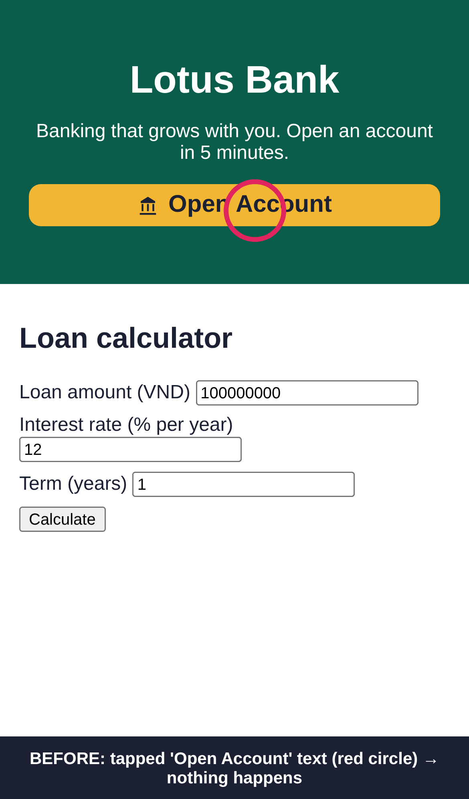

## Fix BUG-102: "Open Account" button does nothing when tapping its text or icon

### What
The "Open Account" button in the hero banner now opens the account form wherever the user taps it: on the text, on the icon, or on the edge. Before this fix, only taps on the button's padding worked.

### Why
- Ticket: **BUG-102**, "Open Account button not working" (reported by Ms. Linh, Lotus Bank Marketing; seen by her manager on his phone)
- This is the page's **main call-to-action**, and taps on it did nothing, with no error shown.
- **Why "sometimes" and "on mobile":** taps fail when they land on the text or the icon, and work when they land on the padding. On mobile the text fills the middle of the button, which is where people tap.

| Device | Button area that worked before the fix |
|---|---|
| Desktop 1280px | 82% (mostly padding, so failures were rare) |
| iPhone 13 | 67%, and the **middle 33% (the text) failed** |

- **Root cause:** `public/app.js` read `event.target.dataset.href`. When the tap landed on the inner `` or `<svg>`, `event.target` was that child element, so `href` was `undefined` and the handler returned without doing anything.

### How
- `public/app.js`: `event.target` → `event.currentTarget` (the element the listener is on, which is always the button). One line, plus a comment.
- `test/open-account.e2e.test.js`: new Playwright end-to-end test covering **2 devices × 3 tap spots = 6 cases**.

### How tested
| Check | Before fix | After fix |
|---|---|---|
| `npm test` (e2e) | 2 pass, **4 fail** (text and icon, on both devices) | **6 pass, 0 fail** |
| Flakiness | — | 3 runs in a row, all green, about 2 s each |
| Manual, iPhone 13 emulation: tap the text | Nothing happens | Form opens ✅ |
| Manual, desktop: click the text, icon and edge | Only the edge works | All work ✅ |
| Other handlers using `event.target` | — | None found (`grep`) |

Hypotheses checked while debugging (each one by running it):
- ❌ JS fails to load on mobile: no console errors, and taps on the edge work.
- ❌ An invisible overlay covers the button: the element under the tap is the `` *inside* the button.
- ✅ The handler reads the wrong element: `event.target` is the ``, which has no `data-href`.

**Steps to verify locally**
1. `npm install`, then `npx playwright install chromium`
2. `npm start` and open http://localhost:3000 in Chrome DevTools → device toolbar → iPhone 13
3. Tap the words **Open Account**. Expect the "Open an account · Step 1 of 3" page.
4. `npm test`: all tests pass

### Screenshots (iPhone 13)
| Before | After |
|---|---|
|  Tapped the text (red circle), nothing happens |  Tapped the text, the form opens |

### Out of scope / follow-ups
- Consider turning the button into a real link (`<a href="/open-account">`) so it works even without JavaScript (see the review).
- Analytics tracking for CTA taps is not part of this ticket.

### Checklist
- [x] Linked to ticket BUG-102
- [x] Failing test written first; it passes after the fix
- [x] Tested on desktop and mobile
- [x] Screenshots added
- [ ] Reviewed by partner

🤖 Generated with [Claude Code](https://claude.com/claude-code)

https://claude.ai/code/session_01Hq76uhit5gSj1MQQjjEHaZ
